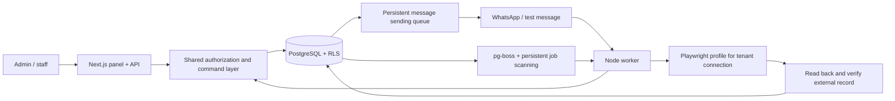

# AfterHours

A locally running AI employee and operations assistant for small businesses.

The current delivery includes a management agent that uses business separation and verified operations, along with a shared AI provider, incoming email drafts, calendar editing and cancellation, combined workflows, and conversation history. Menu names are in English; page descriptions are currently in Turkish. A WhatsApp test message becomes a real record on a local website; after the record is read back and verified, a reply is prepared. The status table below separately shows real account and device verification.

## Local setup

Requires a Mac, Node.js 22.12 or later, pnpm 10.23, and a running Docker Desktop.

```sh
pnpm install --frozen-lockfile
pnpm setup
docker info
pnpm db:up
pnpm db:migrate
pnpm seed
pnpm exec playwright install chromium
```

`pnpm setup` generates unique local database passwords and a session key. It preserves the existing `.env` file and Mac Keychain key. `pnpm seed` runs only against the local `afterhours` demo database. It adds sample records, can be run repeatedly, and does not reset existing business settings.

Run these commands in three separate terminals:

```sh
pnpm fixture
```

```sh
pnpm worker
```

```sh
pnpm dev
```

- Panel: <http://127.0.0.1:3000>
- Controlled record website: <http://127.0.0.1:4001/requests/new>
- PostgreSQL: accessible only through `127.0.0.1:55432`

The panel and worker are two separate application processes. The fixture is a separate test site representing the existing web application used in the first end-to-end demonstration.

Demo accounts are `admin@afterhours.local`, `staff@afterhours.local`, and `other@afterhours.local` for the second business. The generated demo password is stored only in the local file `.data/demo-access.json`. Do not share this file, the `.env` file, or session files. Automatic customer communication is disabled by default. The payment module has been removed; businesses use their e-commerce site for payments.

To run the production build locally, run `pnpm build`, stop the web development process, then use `pnpm --filter @afterhours/web start`. The worker and fixture continue running separately.

## Try the current panel

1. Under **Context → Documents**, add text or a link; you can upload TXT, PNG/JPG/WEBP, PDF, DOCX, and PPTX files. The file limit is 6 MB. If text cannot be extracted from a scanned PDF, the status is shown clearly. Convert older DOC/PPT files to DOCX/PPTX. Added content is persistent and is listed on the same screen.
2. Under **Settings → AI Providers**, save and test an OpenCode Go or OpenAI key, then select the provider to use. Real AI analysis does not run until a key is added. Changes to a document or answer restart the analysis; **Context → Questions** displays conflicts and missing information separately. The badge counts only unanswered questions. Answers are included in subsequent analyses and customer context.
3. Under **Settings → Backoffice Systems**, save the name, address, description, and login details. **Login test** tries the actual credentials in a new browser session. Failed credentials can be saved, but cannot be run when the status is **Login failed**. MFA or unsupported login screens require human review.
4. Under **Workflows**, write steps between named systems using `>`. For example, for the ready-to-use local connection: `Request registration site > check records > every 10 minutes`. A system connection must pass a successful test before it is ready. This special local-read demonstration verifies the actual fixture screen; other natural-language plans require a verified AI provider.
5. Run **Test**, review the result and evidence, and confirm it if correct. A failed or unconfirmed workflow does not become active. A plan that writes data also requires separate admin approval with concrete inputs. **Agent Operations → Human intervention** shows approvals and intervention needs. **Agent work** lists past operations; **More** opens their times, requests, and results.
6. An open-ended time expression adds a schedule to the workflow. The calendar and history appear on the same card. If cron access has not already been granted to a system, the task is paused; creating a workflow does not grant new permissions. Pause the demo schedule after testing.
7. **Settings → Front Desk Channels** brings together customer channels. SMS and IVR API registration screens are available, but they do not yet have working adapters and are not presented as ready.

The first customer flow using the local fixture is also preserved. The three distinct, verified attempts and publishing rule for the previously saved reference job remain in place; new text workflows use one successful test and admin confirmation. Sending a demo message from the inbox does not verify a real WhatsApp account. Enable automatic customer communication only after setting active hours, and turn it off after the demonstration.

## Architecture

```text
apps/web           Next.js panel, Better Auth, management API
apps/worker        Baileys connection, queue, cron, browser execution
packages/core      Drizzle model, RLS context, policies, commands, and adapters
scripts            Secure local setup, migration, seed, fixture, QA session
tests              Database, real Chromium, and provider behavior tests
migrations         Generated schema and manually defined constraints/data migrations
docs               Delivery status and development records
gan-harness        Product scope, acceptance rubric, and evaluation evidence
```



Businesses, user memberships, versioned configuration, connections and permissions, conversations/messages, job drafts/tests, cron, operations, approvals/handoffs, and append-only audit records are persistent. Context files and questions, email drafts, calendar records, management suggestions, and encrypted secrets are stored in separate records. Legacy payment records are retained for history; payment commands and webhook execution are rejected with 410.

Tenant data is related through composite keys and foreign keys. The runtime role cannot bypass RLS; tenant context is set within the transaction using the equivalent of `SET LOCAL`. HTTP requests derive their tenant and role from verified membership. Customer messages cannot set them.

Commands and cron use the same operations runner. Permissions, current connection approval rules, and configuration/job/task versions and admin approval are checked again at execution time. An operation with an uncertain external result is not blindly retried. Sending accepted, delivered, and read are separate statuses. When a conversation is handed off to a person, pending AI replies are canceled.

Browser jobs use a limited, editable DSL. Arbitrary model-generated JavaScript is not executed. Allowed origins and redirects are checked; the operation reference is generated by the application. Password fields are not recorded in training data. A result is not considered successful just because a button was clicked.

AES-256-GCM encryption uses a Mac Keychain key. Encrypted connection secrets are bound to the tenant and connection ID. The panel never returns secret values. Audit details are masked.

## Verification and scope

```sh
pnpm lint
pnpm typecheck
pnpm test
pnpm build
pnpm format:check
```

Database tests require Docker, migrations, and seed setup. Tests use separate, randomly generated tenant records and temporary fixture directories, then clean up their own records. Browser tests run real Chromium. Integration tests use controlled provider responses.

| Area | Local verification | Real account / device |
| --- | --- | --- |
| Core infrastructure | RLS, tenant relationships, admin/staff, audit, approvals, and handoffs | Local Mac/PostgreSQL |
| First flow | Demo message → real fixture record → read-back → demo reply; duplicate protection | Real Baileys account connected; encrypted session reopened. Awaiting delivery of a customer message |
| Context | File extraction, private-link blocking, analysis versions, question/answer changes, and tenant separation; controlled provider responses | Awaiting analysis with the user’s OpenCode Go/OpenAI key |
| Text Workflows | Real Chromium test, named systems, persistent concrete plan/approval, partial-result evidence, confirmation, and linked scheduling | Awaiting the business’s real site and a live AI planning account |
| Backoffice / AI Providers | Correct/incorrect password tests in fresh sessions; encrypted secrets and provider selection | Awaiting real service logins/API keys |
| Email / calendar / MCP | Seven-day paginated sync, restart/duplicate protection, drafts linked to source messages, account/version-controlled calendar changes, and MCP permissions | Awaiting real OAuth accounts and end-to-end provider verification |
| Management agent | Multi-turn history, Context and system status; concrete action plans using permitted commands, persistent step results, and in-transaction version checks | Awaiting business scenarios using the user’s real AI key |
| SMS / IVR | Channel registration and explicit readiness status | No working adapter |
| Audio | Real Mac USB/Bluetooth device check and iPhone–Mac call handoff guide | The user verified playback/answering on Mac and two-way audio during a real call. An AI live-call adapter has not been developed; BlackHole is not used |

The priority order and current verification records are in [AGENTS.md](AGENTS.md) and [docs/task-list.md](docs/task-list.md). Features awaiting live account and device verification are listed separately in the table above.

## Workflow Questions and guided channel setup

When a workflow is saved, the AI reviews its steps and the business’s Context. Uncertainties appear as short questions in the **Questions** tab of each job; the circled number counts unanswered questions. Answers are persistent and used in new analyses. Draft answers are preserved when switching between tabs. If no tested provider is available under AI Providers, the status clearly indicates that setup is pending; the app does not pretend that the AI generated questions or understood the job.

Testing or activation is blocked until questions are resolved. If the text, answers, or context changes, the previous test result becomes invalid; the job must be tested and confirmed again. If permissions, membership, or workflow settings change while a workflow is running, it will not continue to the next system; completed steps remain in the Agent Operations evidence.

Under **Settings → Front Desk Channels → Add channel**, choose a service. Each service displays its own instructions and clear permission options. For WhatsApp, enter a channel name and purpose and save; if the connection service is running, a QR code appears automatically on the same card. On your phone, scan it from **Linked devices → Link a device**. Expired codes are removed, and a pairing-complete status appears once connected.

Gmail, Outlook, and calendar accounts use the provider’s secure account connection flow; users are not asked for JSON, tokens, or developer application IDs. Account connection buttons are awaiting setup because Google/Microsoft app registration has not yet been completed for this Mac. The deployment owner prepares the Google/Microsoft variables in `.env.example`; secrets are not shown in the panel. The first calendar setup uses the account’s primary calendar. SMS/IVR/audio have instructions and recorded requirements, but are not claimed to be working channels.

Tests and real-account limitations for this delivery are recorded in [the verification log](gan-harness/feedback/feedback-workflow-questions-guided-channels.md). Because iCloud blocks dependency reads, the verified production snapshot runs from a temporary local runtime at `http://127.0.0.1:3000`; the source repository has not been moved. New features developed in other chats are verified separately as part of their own deliveries.

## Add MCP to a backoffice system

Go to **Backoffice Systems → Add system → MCP**. Enter a name and description for the system, the HTTPS MCP server address (local HTTP is also supported on this Mac), and a Bearer token if required. The token is stored encrypted and is never displayed again. When editing the same address, leaving the token field blank preserves the existing token; changing the address removes the previous token.

Click **Test connection** on the card. Tool discovery does not run tools or grant permission. Verify that the tools you plan to use are read-only, select them, and then click **Approve tool permissions**. This form grants read-only access to an administrator; write-tool result verification must be defined separately. Every change to the record requires a new test and permission approval.

The connection test verifies the server’s MCP protocol; it does not verify the business account’s identity. This delivery supports Streamable HTTP and an optional Bearer token. OAuth, stdio, and SSE setups are not included. Local tests and live-account limitations are in [the MCP verification log](gan-harness/feedback/feedback-mcp-backoffice.md). The separate MCP preview is at `http://127.0.0.1:3005/backoffice-systems`; updates to canonical3000/ngrok are managed in the other chats’ shared integration delivery.

## Try the combined software delivery

The local production preview built from the current source is available at [127.0.0.1:3003](http://127.0.0.1:3003). Because iCloud blocks dependency reads, an independent verification runtime using the same lockfile is used in `/private/tmp/afterhours-plan-verify`; the source project remains in place. The web app and standard worker run from this runtime. Canonical3000 and public ngrok continue to serve the separately managed guided-channel snapshot; this delivery does not change the public version.

The business provider tested and selected under **AI Providers** is shared across management, customer, Context, and workflow text features. If the provider is not ready, the app shows a waiting or error status; it does not pretend to have generated a real response.

Under **Email**, choose separately whether to sync incoming email for the connected account and whether to prepare drafts with AI. New permissions require admin confirmation and a new account test. The initial sync covers the previous seven days; subsequent checks run every 60 seconds. If the worker stops, syncing resumes from persistent progress. Threads are separated by provider identity, and a message received more than once does not create a second draft. Draft preparation does not grant sending permission; sending requires a separate user action, `email.send` permission, and valid approval.

Under **Calendar**, update and cancellation permissions are disabled initially. After recording permissions, test the account again. Before editing an event, the current version of the connected account, calendar, and event is read. Canceling a specific event requires admin approval; concurrent changes or uncertain results are sent for human review.

**Workflows** can run browser, calendar, email, and permitted MCP steps sequentially in one plan. A verified output from an earlier step is passed to the next step; external write approval is not requested when required inputs remain unresolved. A workflow is not activated until questions are resolved, the test succeeds, and an admin confirms it. If part of the workflow fails, evidence for completed writes is preserved; the entire job is not repeated from the beginning.

**Management Assistant** uses previous conversation and current business status, asks short questions when information is missing, and prepares readable action suggestions. Applying a suggestion goes through the same command services as the panel; record versions and permissions are checked again at execution time. Customer messages, documents, and MCP results do not grant management authority. In the mobile Agent Operations view, the time and **More** are accessible from the first column.

The latest integrated verification passed **199/199 behavior tests across 23 files**, as well as lint, all workspace/tool TypeScript checks, the production build, and formatting checks. Code, TypeScript, React, and security reviews were approved. Four panel flows were verified on desktop and mobile through eight gstack journeys. [Delivery evidence](gan-harness/feedback/feedback-remaining-plan.md) includes command records and screenshots. Controlled AI/API responses and the local Chromium site do not count as verification with real AI, OAuth, or business accounts. SMS/IVR and AI live-audio adapters remain for a later phase.
