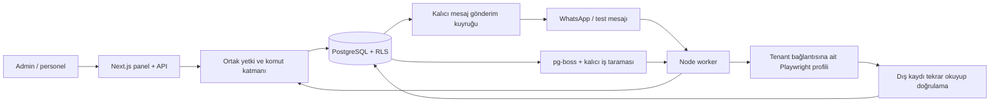

# AfterHours

Küçük işletmeler için yerel Mac üzerinde çalışan AI çalışan ve operasyon asistanı.

Güncel teslim işletme ayrımı ve doğrulanmış işlemlerin yanında ortak AI sağlayıcısını, gelen e-posta taslaklarını, takvim düzenleme/iptalini, birleşik workflows ve konuşma geçmişini kullanan yönetim ajanını içerir. Menü adları İngilizce; sayfa açıklamaları şimdilik Türkçedir. WhatsApp test mesajı gerçek bir yerel web kaydına dönüşür; kayıt tekrar okunup doğrulanınca yanıt hazırlanır. Gerçek hesap ve cihaz doğrulamaları aşağıdaki durum tablosunda ayrıca gösterilir.

## Yerel kurulum

Mac, Node.js 22.12 veya üzeri, pnpm 10.23 ve çalışan Docker Desktop gerekir.

```sh
pnpm install --frozen-lockfile
pnpm setup
docker info
pnpm db:up
pnpm db:migrate
pnpm seed
pnpm exec playwright install chromium
```

`pnpm setup` benzersiz yerel veritabanı parolaları ve oturum anahtarı oluşturur. Mevcut `.env` ve Mac Keychain anahtarını korur. `pnpm seed` yalnızca yerel `afterhours` demo veritabanında çalışır; örnek kayıtları ekler, tekrar çalıştırılabilir ve mevcut işletme ayarlarını sıfırlamaz.

Üç ayrı terminalde çalıştırın:

```sh
pnpm fixture
```

```sh
pnpm worker
```

```sh
pnpm dev
```

- Panel: <http://127.0.0.1:3000>
- Kontrollü kayıt sitesi: <http://127.0.0.1:4001/requests/new>
- PostgreSQL: yalnızca `127.0.0.1:55432` üzerinden erişilir.

Panel ve worker iki uygulama sürecidir. Fixture, ilk uçtan uca gösterimde kullanılan mevcut web uygulamasını temsil eden ayrı test sitesidir.

Demo hesapları `admin@afterhours.local`, `staff@afterhours.local` ve ikinci işletme için `other@afterhours.local`. Üretilen demo parola `.data/demo-access.json` içinde yalnızca yerel dosyada tutulur. Bu dosyayı, `.env` dosyasını veya oturum dosyalarını paylaşmayın. Varsayılan olarak otomatik müşteri iletişimi kapalıdır. Ödeme modülü kaldırılmıştır; ödeme için işletmenin e-ticaret sitesi kullanılır.

Üretim derlemesini yerelde çalıştırmak için `pnpm build` sonrasında web geliştirme sürecini kapatıp `pnpm --filter @afterhours/web start` kullanın. Worker ve fixture ayrı çalışmaya devam eder.

## Güncel paneli deneme

1. **Context → Belgeler** altında metin veya bağlantı ekleyin; TXT, PNG/JPG/WEBP, PDF, DOCX ve PPTX yükleyebilirsiniz. Dosya sınırı 6 MB; taranmış PDF için metin çıkarılamazsa durum açıkça gösterilir. Eski DOC/PPT dosyalarını DOCX/PPTX biçimine dönüştürün. Eklenen içerik kalıcıdır ve aynı ekranda listelenir.
2. **Settings → AI Providers** altında OpenCode Go veya OpenAI anahtarını kaydedip test edin ve kullanılacak sağlayıcıyı seçin. Anahtar eklenmeden gerçek AI analizi yapılmaz. Belge veya yanıt değişikliği analizi yeniden başlatır; **Context → Sorular** çelişkileri/eksikleri ayrı gösterir. Rozet yalnız yanıtlanmayan soruları sayar. Cevaplar sonraki analize ve müşteri bağlamına girer.
3. **Settings → Backoffice Systems** altında isim, adres, açıklama ve giriş bilgilerini kaydedin. **Login test** gerçek kimlik bilgilerini yeni bir tarayıcı oturumunda dener. Başarısız kayıt saklanabilir; **Login failed** durumunda çalıştırılamaz. MFA veya desteklenmeyen giriş ekranı insan incelemesi gerektirir.
4. **Workflows** altında adlandırılmış sistemler arasında `>` ile adımları yazın. Örneğin hazır yerel bağlantı için `Talep kayıt sitesi > kayıtları kontrol et > her 10 dakika`. Sistem bağlantısı önce başarılı testle hazır olmalıdır. Bu özel yerel okuma gösterimi gerçek fixture ekranını doğrular; diğer doğal dil planları doğrulanmış AI sağlayıcısı gerektirir.
5. **Test** çalıştırın, sonucu ve kanıtı inceleyip doğruysa teyit edin. Başarısız veya teyit edilmemiş workflow aktif olmaz. Yazma planı somut girdileriyle ayrıca admin onayı ister. **Agent Operations → İnsan müdahalesi** onayları ve müdahale ihtiyaçlarını gösterir. **Ajanın yaptığı işler** geçmiş operasyonları listeler; **More** zaman, talep ve sonuçları açar.
6. Açık aralık ifadesi workflow'a zamanlama ekler. Takvim ve geçmiş aynı kartta görünür. Cron erişimi önceden verilmemiş sistemde görev duraklatılır; workflow oluşturmak yeni yetki vermez. Test bittikten sonra demo zamanlamasını duraklatın.
7. **Settings → Front Desk Channels** müşteri kanallarını toplar. SMS ve IVR API kayıt ekranları vardır; henüz çalışır adaptörleri yoktur ve hazır olarak gösterilmezler.

Yerel fixture ile ilk müşteri akışı da korunur. Eski kayıtlı referans işinin üç farklı doğrulanmış denemesi ve yayınlama kuralı sürer; yeni metin workflow'ları tek başarılı test ve admin teyidi kullanır. Gelen kutusundan demo mesajı gönderilmesi gerçek WhatsApp hesabı doğrulaması değildir. Otomatik müşteri iletişimini ancak aktif saatleri belirleyerek açın; gösterim sonrası kapatın.

## Mimari

```text
apps/web           Next.js paneli, Better Auth, yönetim API’si
apps/worker        Baileys bağlantısı, kuyruk, cron, tarayıcı yürütme
packages/core      Drizzle modeli, RLS bağlamı, politikalar, komutlar ve adaptörler
scripts            Güvenli yerel kurulum, migration, seed, fixture, QA oturumu
tests              Veritabanı, gerçek Chromium ve sağlayıcı davranış testleri
migrations         Oluşturulan şema ve elle tanımlanan kısıt/veri geçişleri
docs               Teslim durumu ve geliştirme kayıtları
gan-harness        Ürün kapsamı, kabul rubriği ve değerlendirme kanıtları
```



İşletme, kullanıcı üyeliği, sürümlü yapılandırma, bağlantı ve izinler, konuşma/mesaj, iş taslağı/deneme, cron, operasyon, onay/devir ve append-only denetim kaydı kalıcıdır. Context dosyaları ve soruları, e-posta taslakları, takvim kayıtları, yönetim önerileri ve şifreli sırlar ayrı kayıtlar taşır. Eski ödeme kayıtları geçmiş için korunur; ödeme komutları ve webhook çalışması 410 ile reddedilir.

Tenant verileri birleşik anahtar ve foreign key ile ilişkilendirilir. Çalışma rolü RLS’yi atlayamaz; tenant bağlamı işlem içinde `SET LOCAL` eşdeğeriyle verilir. HTTP işlemlerinin tenant ve rolü doğrulanmış üyelikten gelir. Müşteri mesajı bunları belirleyemez.

Komutlar ve cron aynı operasyon yürütücüsünü kullanır. İzinler, güncel bağlantı onay kuralları, yapılandırma/iş/görev sürümü ve admin onayı yürütme anında tekrar kontrol edilir. Dış sonucun belirsiz olduğu işlem körlemesine tekrarlanmaz. Gönderim kabulü, teslim ve okunma ayrı durumdur. İnsan devrinde bekleyen AI yanıtları iptal edilir.

Tarayıcı işleri sınırlı ve düzenlenebilir bir DSL kullanır. Keyfi model JavaScript’i çalıştırılmaz. İzinli origin ve yönlendirmeler denetlenir; işlem referansı uygulama tarafından oluşturulur. Şifre alanları öğretim kaydına alınmaz. Sonuç bir düğmeye tıklamakla başarılı sayılmaz.

Mac Keychain anahtarıyla AES-256-GCM şifreleme yapılır; şifreli bağlantı sırları tenant ve bağlantı kimliğine bağlanır. Panel sır değerlerini geri döndürmez. Audit bilgileri maskelenir.

## Doğrulama ve kapsam

```sh
pnpm lint
pnpm typecheck
pnpm test
pnpm build
pnpm format:check
```

Veritabanı testleri Docker/migration/seed kurulumunu gerektirir. Testler ayrı rastgele tenant kayıtları ve geçici fixture dizinleri kullanır; kendi kayıtlarını temizler. Tarayıcı testleri gerçek Chromium çalıştırır. Entegrasyon testleri kontrollü sağlayıcı yanıtları kullanır.

| Alan                      | Yerel doğrulama                                                                                                                                          | Gerçek hesap / cihaz                                                                                                                       |
| ------------------------- | -------------------------------------------------------------------------------------------------------------------------------------------------------- | ------------------------------------------------------------------------------------------------------------------------------------------ |
| Temel yapı                | RLS, tenant ilişkileri, admin/personel, audit, onay ve devir                                                                                             | Yerel Mac/PostgreSQL                                                                                                                       |
| İlk akış                  | Demo mesajı → gerçek fixture kaydı → read-back → demo yanıt; tekrar koruması                                                                             | Gerçek Baileys hesabı bağlandı; şifreli oturum yeniden açıldı. Müşteri mesajı teslimi bekliyor                                             |
| Context                   | Dosya çıkarma, özel bağlantı engeli, analiz sürümü, soru/yanıt değişimleri ve tenant ayrımı; sağlayıcı yanıtları kontrollü                               | Kullanıcının OpenCode Go/OpenAI anahtarıyla analiz bekliyor                                                                                |
| Text Workflows            | Gerçek Chromium testi, isimli sistemler, kalıcı somut plan/onay, kısmi sonuç kanıtı, teyit ve bağlı zamanlama                                            | İşletmenin gerçek sitesi ve canlı AI planlama hesabı bekliyor                                                                              |
| Backoffice / AI Providers | Taze oturumla doğru/yanlış parola testi; şifreli sırlar ve sağlayıcı seçimi                                                                              | Gerçek servis girişleri/API anahtarları bekliyor                                                                                           |
| E-posta / takvim / MCP    | Yedi günlük sayfalı eşitleme, yeniden başlama/tekrar koruması, kaynak mesajına bağlı taslak, hesap/sürüm kontrollü takvim değişiklikleri ve MCP izinleri | Gerçek OAuth hesapları ve uçtan uca sağlayıcı doğrulaması bekliyor                                                                         |
| Yönetim ajanı             | Çok turlu geçmiş, Context ve sistem durumları; izin verilen komutlardan somut eylem planları, kalıcı adım sonuçları ve işlem içinde sürüm kontrolü       | Kullanıcının gerçek AI anahtarıyla işletme senaryoları bekliyor                                                                            |
| SMS / IVR                 | Kanal kaydı ve açık hazır olma durumu                                                                                                                    | Çalışır adaptör yok                                                                                                                        |
| Ses                       | Gerçek Mac USB/Bluetooth cihaz kontrolü ve iPhone–Mac arama aktarımı rehberi                                                                             | Kullanıcı gerçek aramada Mac’te çalma/yanıtlama ve iki yönlü sesi doğruladı. AI canlı arama adaptörü geliştirilmedi; BlackHole kullanılmaz |

Öncelik sırası ve güncel doğrulama kayıtları [AGENTS.md](AGENTS.md) ve [docs/task-list.md](docs/task-list.md) içindedir. Canlı hesap ve cihaz doğrulaması bekleyen özellikler yukarıdaki tabloda ayrıca gösterilir.

## Workflow Questions ve kolay kanal kurulumu

Workflow kaydedildiğinde AI adımları ve işletmenin Context bilgisini inceler. Belirsizlikler her işin **Questions** sekmesinde kısa sorular olarak görünür; daire içindeki sayı cevaplanmayan soruları sayar. Cevaplar kalıcıdır ve yeni analizde kullanılır. Sekmeler arasında yazılan cevap taslağı korunur. AI Providers altında test edilmiş sağlayıcı yoksa durum açıkça bağlantı bekler; AI soru üretmiş veya işi anlamış gibi gösterilmez.

Sorular tamamlanmadan Test veya aktivasyon yapılmaz. Metin/cevap/bağlam değişirse eski test sonucu geçersiz olur; iş yeniden test ve teyit ister. Çalışırken izin, üyelik veya workflow değişirse sonraki sistemde devam edilmez; yapılan adımlar Agent Operations kanıtında kalır.

**Settings → Front Desk Channels → Kanal ekle** ekranında hizmeti seçin. Her hizmet kendi yönergelerini ve anlaşılır izin seçeneklerini gösterir. WhatsApp için kanala isim ve amaç verip kaydedin; bağlantı hizmeti çalışıyorsa QR kodu aynı kartta otomatik görünür. Telefonunuzda Bağlı cihazlar → Cihaz bağla ile okutun. Süresi dolan kod kaldırılır, bağlantı kurulunca eşleme tamamlandı bilgisi görünür.

Gmail, Outlook ve takvimlerde sağlayıcının güvenli hesabıyla bağlantı akışı kullanılır; kullanıcıdan JSON, token veya geliştirici uygulama kimliği istenmez. Bu Mac için Google/Microsoft uygulama kaydı henüz yapılmadığından hesap bağlama düğmeleri kurulum bekler. Dağıtım sorumlusu `.env.example` içindeki Google/Microsoft değişkenlerini hazırlar; sırlar panelde gösterilmez. İlk takvim kurulumunda hesabın ana takvimi kullanılır. SMS/IVR/ses için yönergeler ve ihtiyaç kaydı vardır, çalışır kanal iddiası yoktur.

Bu teslimin testleri ve gerçek hesap sınırları [doğrulama kaydında](gan-harness/feedback/feedback-workflow-questions-guided-channels.md) tutulur. iCloud okuma engeli nedeniyle doğrulanan production snapshot geçici yerel runtime'dan `http://127.0.0.1:3000` üzerinde çalışır; kaynak repo taşınmadı. Diğer sohbetlerde geliştirilen yeni özellikler kendi teslimlerinde ayrıca doğrulanır.

## Backoffice sistemine MCP ekleme

**Backoffice Systems → Sistem ekle → MCP** seçin. Sisteme isim ve açıklama verin; HTTPS MCP sunucu adresini (bu Mac üzerinde yerel HTTP de desteklenir) ve gerekiyorsa Bearer tokenini kaydedin. Token şifreli saklanır ve geri gösterilmez. Aynı adresi düzenlerken boş token alanı mevcut tokeni korur; adres değişince önceki token kaldırılır.

Karttan **Bağlantıyı test et** düğmesine basın. Araç keşfi iş aracı çalıştırmaz ve izin vermez. Kullanacağınız araçların salt okunur olduğunu doğrulayıp seçin, ardından **Araç izinlerini onayla** düğmesine basın. Bu form yalnız yöneticiye salt okunur kullanım verir; yazma araçlarının sonuç doğrulaması ayrıca tanımlanmalıdır. Her kayıt değişikliği yeniden test ve izin onayı gerektirir.

Bağlantı testi sunucunun MCP protokolünü doğrular; işletme hesabının kimliğini doğruladığı anlamına gelmez. Bu teslim Streamable HTTP ve isteğe bağlı Bearer tokenini destekler. OAuth, stdio ve SSE kurulumları dahil değildir. Yerel testler ve canlı hesap sınırları [MCP doğrulama kaydında](gan-harness/feedback/feedback-mcp-backoffice.md) bulunur. Ayrı MCP önizlemesi `http://127.0.0.1:3005/backoffice-systems`; canonical3000/ngrok güncellemesi diğer chatlerin ortak entegrasyon tesliminde yönetilir.

## Birleşik yazılım teslimini deneme

Güncel kaynakla oluşturulan yerel üretim önizlemesi [127.0.0.1:3003](http://127.0.0.1:3003) üzerindedir. iCloud bağımlılık okuma engeli nedeniyle aynı lockfile ile `/private/tmp/afterhours-plan-verify` içinde bağımsız doğrulama runtime'ı kullanılır; kaynak proje yerinde kalır. Web ve normal worker bu runtime'dan çalışır. Canonical3000 ve public ngrok, ayrı yönetilen guided-channel snapshot'ını sunmaya devam eder; bu teslim public sürümü değiştirmez.

**AI Providers** altında test edilip seçilen işletme sağlayıcısı yönetim, müşteri, Context ve workflow metinlerinde ortak kullanılır. Sağlayıcı hazır değilse bekleme veya hata durumu gösterilir; gerçek yanıt üretilmiş gibi gösterilmez.

**Email** ekranında bağlı hesap için gelen e-postaları eşitlemeyi ve AI ile taslak hazırlamayı ayrı seçin. Yeni izinler admin teyidi ve hesabın yeniden testini gerektirir. İlk aktarım son yedi günü, sonraki kontroller 60 saniyelik aralıkları kapsar; worker durursa kalıcı ilerlemeden devam edilir. Zincirler sağlayıcı kimliğiyle ayrılır, tekrar alınan mesaj ikinci taslak oluşturmaz. Taslak hazırlama gönderim izni vermez; gönderim ayrı kullanıcı eylemi, `email.send` yetkisi ve geçerli onay gerektirir.

**Calendar** ekranında güncelleme/iptal izinleri başlangıçta kapalıdır. İzin kaydından sonra hesabı yeniden test edin. Kayıt düzenlemeden önce bağlı hesap, takvim ve etkinliğin güncel sürümü okunur. İptal somut kayda admin onayı ister; eşzamanlı değişiklik veya belirsiz sonuç insan incelemesine bırakılır.

**Workflows** tarayıcı, takvim, e-posta ve izinli MCP adımlarını bir planda sırayla çalıştırabilir. Önceki doğrulanmış çıktı sonraki adıma girer; çözülmemiş girdilerle dış yazma onayı istenmez. Sorular, başarılı test ve admin teyidi tamamlanmadan etkinleşmez. Kısmi başarısızlıkta tamamlanan yazmaların kanıtı korunur; tüm iş baştan tekrar edilmez.

**Management Assistant** önceki konuşmayı ve güncel işletme durumunu kullanır; eksik bilgi için kısa sorular sorar, okunabilir eylem önerileri hazırlar. Öneriyi uygulamak panelle aynı komut hizmetlerinden geçer; uygulama anında ilgili kayıtların sürümleri ve izinler yeniden kontrol edilir. Müşteri mesajları, belgeler ve MCP sonuçları yönetim yetkisi vermez. Agent Operations mobil görünümünde zaman ve **More** ilk sütundan erişilir.

Son bütünleşik doğrulamada **23 dosyada 199/199 davranış testi**, lint, tüm workspace/araç TypeScript kontrolleri, üretim build'i ve biçim kontrolü geçti. Kod, TypeScript, React ve güvenlik incelemeleri onaylandı. Dört panel akışı masaüstü/mobilde sekiz gstack yolculuğuyla doğrulandı. [Teslim kanıtı](gan-harness/feedback/feedback-remaining-plan.md) komut kayıtlarını ve ekran görüntülerini içerir. Kontrollü AI/API cevapları ve yerel Chromium sitesi, gerçek AI/OAuth/işletme hesabı doğrulaması olarak değerlendirilmez. SMS/IVR ve AI canlı ses adaptörleri sonraki aşamadadır.
